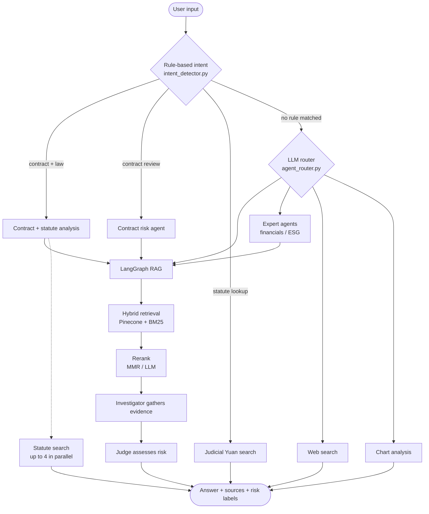

# Contract Compliance Agent

> Upload a contract and the system flags high-risk clauses, suggests edits, and cites the statutes behind each finding. It does a first pass for a human reviewer, who still makes the call.

[](https://github.com/falltwo/Contract-compliance-agent/actions/workflows/ci.yml)
[](LICENSE)
[](https://www.python.org/downloads/)
[](https://vuejs.org/)

[繁體中文](README.md) | **English**

Finalist in the 2nd Best AI Awards (智慧創新大賞), run by Taiwan's Ministry of Economic Affairs in 2026. Built by a team of three between March and June 2026.

Most of the time in a first-pass contract review goes into reading every clause and then looking up the relevant law for each one. This project connects those two steps. It finds risky clauses in the contract, looks up the matching articles on Taiwan's Judicial Yuan and national law databases, and returns risk cards that each point to the contract passage and the statute they rely on.

The system works in Traditional Chinese and targets Taiwanese law.

## What it does

Upload a contract (`.pdf`, `.docx`, `.txt`, `.md`) and ask, for example:

```text
請審閱這份合約的風險條款，並列出相對應的法律依據
(Review this contract's risk clauses and list the legal basis for each.)
```

You get structured risk cards. Each one has:

- The quoted clause and its article number; clicking the card jumps to that spot in the document preview
- A risk level (high / medium / low)
- The legal basis, linked to the Judicial Yuan or the national law database
- A suggested edit. Before suggesting that something be "added", the model is told to check whether another clause already covers it

You can also ask questions against the knowledge base ("How long does this NDA's confidentiality obligation last?") or just look up a statute. In strict mode, answers come only from the knowledge base, and the model doesn't fill gaps with its own legal knowledge.

## How it works

### Rules first, the model only when rules can't decide

`intent_detector.py` uses keyword matching for requests with a clear intent, such as contract review, statute lookup and web scraping. Those requests never call an LLM. Anything the rules can't classify goes to `agent_router.py`, where the model picks a tool.

`eval/` holds two routing sets (20 general questions, 10 contract questions) for measuring routing accuracy, tool success rate and latency.

### Hybrid retrieval with a legal term dictionary

Vector search (Pinecone) and BM25 keyword search run side by side and are merged with RRF. BM25 tokenizes with jieba, whose default dictionary splits terms like 懲罰性違約金 (punitive liquidated damages) into pieces. `rag_common.py` adds 60 contract and legal terms, and `BM25_JIEBA_USERDICT` lets you load your own.

### Investigator and Judge are separate prompts

Contract review runs in two stages. The Investigator gathers the relevant clauses and knowledge-base references; the Judge may only reason from what the Investigator hands over. When an answer is wrong, you can tell whether the evidence was missing or the judgment was off.

### A cap on LLM calls per query

One RAG query makes at most 12 LLM calls (`RAG_MAX_LLM_CALLS`). Past that it stops and reports instead of retrying forever. Lightweight mode (`.env.lightweight`) uses a lower cap and turns off multi-query.

### Live progress

The contract + statute flow takes a while. `progress.py` uses a ContextVar to pass progress events out of a ThreadPoolExecutor into an SSE stream, and the frontend shows three stages: retrieving the contract, searching statutes, writing the assessment.

### Request flow



## Quick start

You need Python 3.13+, [uv](https://docs.astral.sh/uv/), a Pinecone index, and either a Gemini API key or a local Ollama. Statute and web lookup also need a Tavily API key.

```bash
cp .env.example .env      # fill in PINECONE_API_KEY, PINECONE_INDEX, CHAT_PROVIDER, ...
uv sync
uv run rag_ingest.py      # ingest the sample contracts in data/
uv run streamlit run streamlit_app.py   # http://localhost:8501
```

Main environment variables:

| Variable | Notes |
|------|------|
| `PINECONE_API_KEY`, `PINECONE_INDEX` | Required |
| `CHAT_PROVIDER` | `gemini` or `ollama` |
| `GOOGLE_API_KEY` | Required with Gemini |
| `OLLAMA_CHAT_MODEL`, `OLLAMA_EMBED_MODEL` | Set when using Ollama |
| `TAVILY_API_KEY` | Optional; enables statute and web lookup |

### Fully local

It runs without any cloud API. Light steps (routing, rewriting, reranking) go to a small model and only generation uses a larger one:

```bash
cp .env.lightweight .env
ollama pull gemma3:4b-it-qat              # routing / rewrite / rerank
ollama pull gemma3:12b                    # generation
ollama pull snowflake-arctic-embed2:568m  # embeddings
```

Our standard setup on the DGX uses `gemma3:27b` for generation, with an optional contract re-check model set by `OLLAMA_CONTRACT_RISK_VERIFY_MODEL` (e.g. `gpt-oss:120b`). Every stage can be pointed at its own model through `OLLAMA_*_MODEL`; see `.env.example`.

### Web app (FastAPI + Vue)

```bash
uv run uvicorn backend.main:app --reload --port 8000   # API docs at /docs
cd web && npm ci && npm run dev                        # /chat, /upload, /sources, /admin
```

The admin page lists uploaded sources, runs evaluations, and shows loaded Ollama models and systemd service status.

## Tests and evaluation

```bash
uv sync --extra dev
uv run pytest                                                     # 144 tests
uv run python eval/run_eval.py                                    # general routing set
uv run python eval/run_eval.py --eval-set eval/eval_set_contract.json
```

On every push to `main` and every PR, CI runs a gitleaks secret scan, pytest, frontend type checks and build, and Playwright E2E. When a push to `main` passes all of them, it deploys to the team's DGX Spark over Tailscale SSH. Evaluation results are written to `eval/runs/`.

## Deployment

```bash
bash scripts/install_dgx_services.sh   # first-time systemd setup
bash scripts/deploy_contract_agent.sh  # manual update
```

Services listen on `:8000` (API), `:4173` (frontend) and `:4174` (admin). Operations notes (in Chinese) are in [`docs/DGX_網站使用與維運手冊_v1.2.md`](docs/DGX_網站使用與維運手冊_v1.2.md).

## Project layout

```text
intent_detector.py   rule-based intent detection
agent_router.py      LLM routing and tool dispatch
rag_graph.py         LangGraph RAG flow (Investigator / Judge)
rag_common.py        Pinecone, embeddings, BM25 and the legal term dictionary
expert_agents.py     contract risk, financial and ESG expert agents
ingest_service.py    document ingestion and source management
streamlit_app.py     demo UI
backend/             FastAPI
web/                 Vue 3 frontend and Playwright E2E
eval/                routing eval sets and runner
tests/               pytest
```

## Limitations

- The output is not legal advice. The model can miss issues, misjudge them or cite the wrong article, and a qualified person has to check the results.
- Statute lookup depends on external search, so the version and applicability of each article still need a human check.
- We have not formally measured how many LLM calls the rule-first routing saves, or how much review time the tool saves in practice.

## Team

- [@falltwo](https://github.com/falltwo): backend and RAG retrieval, local models and DGX deployment, CI/CD, evaluation and the admin console
- [@ewiwi22255](https://github.com/ewiwi22255): LLM routing, expert agents, chat frontend
- [@wweyuiop1205-lgtm](https://github.com/wweyuiop1205-lgtm): initial system skeleton and first CI setup

## License

[MIT](LICENSE)
