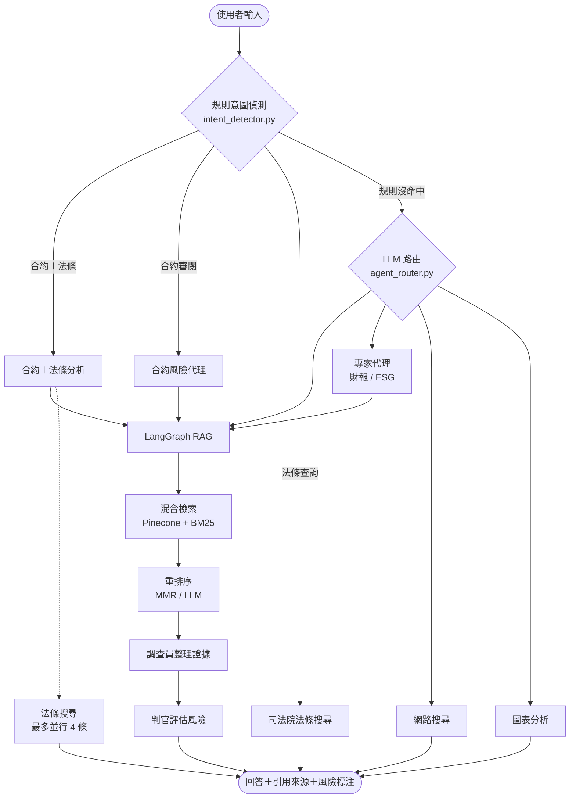

# Contract Compliance Agent

> 上傳一份合約，系統會標出高風險條款，附上修改建議和法條出處。這是幫人做第一輪審閱的工具，最後仍要由人判斷。

[](https://github.com/falltwo/Contract-compliance-agent/actions/workflows/ci.yml)
[](LICENSE)
[](https://www.python.org/downloads/)
[](https://vuejs.org/)

**繁體中文** | [English](README.en.md)

2026 經濟部第二屆「智慧創新大賞（Best AI Awards）」入圍作品，三人團隊於 2026 年 3 月到 6 月開發。

合約初審最花時間的，是逐條讀完、再一條條查法條。這個專案把兩件事接起來：先從合約找出有風險的條款，再到司法院和全國法規資料庫查對應條文，最後產出風險卡片，每張都標明引用合約哪一段、依據哪一條法律。

## 它會做什麼

上傳合約（`.pdf`、`.docx`、`.txt`、`.md`）之後，可以直接問：

```text
請審閱這份合約的風險條款，並列出相對應的法律依據
```

系統回傳結構化的風險卡片，每張包含：

- 原文引述與條號，點卡片可以跳到右側預覽的原文位置
- 風險等級（高／中／低）
- 法條依據，連到司法院或全國法規資料庫
- 修改建議。產生建議前，模型會先檢查全文是否已有條款涵蓋，避免建議「加入」合約裡早就有的東西

也可以只問知識庫（「這份 NDA 的保密義務持續多久？」），或單純查法條（「政府採購法第 99 條」）。開啟嚴格模式時，回答只根據知識庫內容，不讓模型自行補充法律常識。

## 怎麼做的

### 先用規則分流，判斷不了才問模型

`intent_detector.py` 用關鍵字比對處理意圖明確的請求，例如合約審閱、法條查詢、網頁擷取，這些請求不會呼叫 LLM。規則判斷不了的，才交給 `agent_router.py` 讓模型決定要用哪個工具。

`eval/` 裡有兩組路由題（通用 20 題、合約 10 題），用來量路由準確率、工具成功率和延遲。

### 混合檢索，補上法律術語辭典

向量檢索（Pinecone）和 BM25 關鍵字檢索並行，再用 RRF 合併結果。BM25 用 jieba 分詞；jieba 預設辭典會把「懲罰性違約金」「定型化契約」這類詞切碎，所以 `rag_common.py` 內建 60 個合約與法律術語，也可以用 `BM25_JIEBA_USERDICT` 掛自己的辭典。

### 調查員和判官分開

合約審閱拆成兩段 prompt：調查員（Investigator）整理相關條文和知識庫依據，判官（Judge）只能根據調查員交來的內容下判斷。答案出錯時，可以先看是證據沒撈到，還是判斷錯了。

### 每次查詢有呼叫上限

一次 RAG 查詢最多呼叫 LLM 12 次（`RAG_MAX_LLM_CALLS`），超過就停下來回報，不會無限重試。輕量模式（`.env.lightweight`）的上限更低，也會關掉 multi-query。

### 進度即時回傳

「合約＋法條」流程要跑一段時間。`progress.py` 用 ContextVar 把 ThreadPoolExecutor 裡的進度事件送到 SSE，前端顯示「檢索合約 → 搜尋法條 → 產出評估」三段進度。

### 請求流程



## 快速開始

需要 Python 3.13+、[uv](https://docs.astral.sh/uv/)、一個 Pinecone index，以及 Gemini API 或本機 Ollama 擇一。要查法條或網路的話，另外需要 Tavily API key。

```bash
cp .env.example .env      # 填入 PINECONE_API_KEY、PINECONE_INDEX、CHAT_PROVIDER 等
uv sync
uv run rag_ingest.py      # 灌入 data/ 裡的範例合約
uv run streamlit run streamlit_app.py   # http://localhost:8501
```

主要環境變數：

| 變數 | 說明 |
|------|------|
| `PINECONE_API_KEY`、`PINECONE_INDEX` | 必填 |
| `CHAT_PROVIDER` | `gemini` 或 `ollama` |
| `GOOGLE_API_KEY` | 用 Gemini 時必填 |
| `OLLAMA_CHAT_MODEL`、`OLLAMA_EMBED_MODEL` | 用 Ollama 時填 |
| `TAVILY_API_KEY` | 選填，啟用法條與網路查詢 |

### 全本機執行

沒有雲端 API 也能跑。輕任務（路由、改寫、重排序）交給小模型，主生成才用大一點的模型：

```bash
cp .env.lightweight .env
ollama pull gemma3:4b-it-qat              # 路由／改寫／重排序
ollama pull gemma3:12b                    # 主生成
ollama pull snowflake-arctic-embed2:568m  # embedding
```

在 DGX 上的標準設定是主生成 `gemma3:27b`，合約覆核可另外指定 `OLLAMA_CONTRACT_RISK_VERIFY_MODEL`（例如 `gpt-oss:120b`）。各階段的模型都能用 `OLLAMA_*_MODEL` 個別指定，見 `.env.example`。

### Web 版（FastAPI + Vue）

```bash
uv run uvicorn backend.main:app --reload --port 8000   # API 文件：/docs
cd web && npm ci && npm run dev                        # /chat、/upload、/sources、/admin
```

後台可以看上傳來源、跑評測、查 Ollama 已載入的模型和 systemd 服務狀態。

## 測試與評測

```bash
uv sync --extra dev
uv run pytest                                                     # 144 項測試
uv run python eval/run_eval.py                                    # 通用路由題
uv run python eval/run_eval.py --eval-set eval/eval_set_contract.json
```

每次 push 到 `main` 和每個 PR，CI 都會跑 gitleaks 金鑰掃描、pytest、前端型別檢查與建置、Playwright E2E。push 到 `main` 且全部通過後，會透過 Tailscale SSH 自動部署到團隊的 DGX Spark。評測結果寫入 `eval/runs/`。

## 部署

```bash
bash scripts/install_dgx_services.sh   # 第一次安裝 systemd 服務
bash scripts/deploy_contract_agent.sh  # 手動更新
```

服務會跑在 `:8000`（API）、`:4173`（前台）、`:4174`（後台）。維運細節見 [`docs/DGX_網站使用與維運手冊_v1.2.md`](docs/DGX_網站使用與維運手冊_v1.2.md)。

## 專案結構

```text
intent_detector.py   規則意圖偵測
agent_router.py      LLM 路由與工具分派
rag_graph.py         LangGraph RAG 流程（調查員／判官）
rag_common.py        Pinecone、embedding、BM25 與法律術語辭典
expert_agents.py     合約風險、財報、ESG 專家代理
ingest_service.py    文件灌入與來源管理
streamlit_app.py     Demo 介面
backend/             FastAPI
web/                 Vue 3 前端與 Playwright E2E
eval/                路由評測題與執行器
tests/               pytest
```

## 限制

- 輸出不是法律意見。模型可能漏判、誤判或引錯條文，結果必須由懂法律的人複核。
- 法條查詢依賴外部搜尋，查到的條文版本與適用性仍要人工確認。
- 「規則先分流」能省多少 LLM 呼叫、審閱實際能省多少時間，我們沒有做正式量測。

## 團隊

- [@falltwo](https://github.com/falltwo)：後端與 RAG 檢索、本機模型與 DGX 部署、CI/CD、評測與管理後台
- [@ewiwi22255](https://github.com/ewiwi22255)：LLM 路由、專家代理、聊天前台
- [@wweyuiop1205-lgtm](https://github.com/wweyuiop1205-lgtm)：初版系統骨架與 CI 初版

## License

[MIT](LICENSE)
